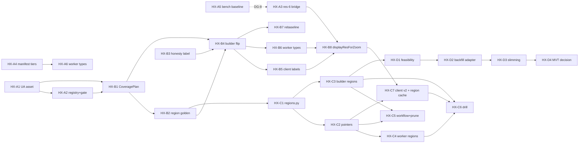

# ROADMAP — ADR-0010: Adaptive Hex Coverage Tiers and Regional Backfill

Executable plan for `docs/adr/0010-adaptive-hex-coverage-tiers-and-regional-backfill.md`
(Proposed, 2026-10-12). Vocabulary follows `CONTEXT.md` exactly (Metro, Submarket,
Urban Anchor, Coverage tier, Display ladder, LOD, Honesty labels, Snapshot,
Release, Region, Backfill, Golden count). The technical spec that these work-item
IDs bind to is `docs/specs/adaptive-hex-coverage.md`.

Labeling convention used throughout: **[fact]** = observed in the repo or measured
(source cited); **[claim]** = asserted by ADR-0010 or a plan author without a
repo measurement; **[inference]** = derived by reading code, not executed;
**TBD** = unknown, with the work item that establishes it. Nothing below is a
baseline unless it is marked [fact].

Naming note [fact]: the repo already carries a *different* "hex-coverage Stage
A/B" (`docs/plans/2026-10-07-hex-coverage-stage-ab.md`: coverage states,
release-qualified publication; shipped — see `dashboard.py` "Coverage
publication helpers (hex-coverage Stage A)" and `apps/dashboard/src/index.ts`
`snapshot/current`). Stages in this document are **ADR-0010 Stages A–D** and are
always written with the `HX-` prefix to avoid collision.

---

## 1. Current state (measured facts)

| # | Fact | Source |
|---|------|--------|
| F1 | 157 registered metros; 53,799 unique res-9 metro cells pinned as the client-benchmark fixture. | `scripts/autoresearch_coverage.json`; git log `6e7b493` ("157 metros/53799 cells") |
| F2 | Detail-tier coverage = union of bounded k-rings (`DEFAULT_MAX_RING=3`, `DEFAULT_MAX_DIST_KM=1.5`) around hand-registered submarket points; `assign_cell` owner lookup bounded at `max_dist_km=25.0`. | `apps/api/src/spatial/coverage.py:55-56,71,121-124` |
| F3 | National base tier golden counts: res 4 = 5,251; res 5 = 5,251×7 = 36,757; res 6 = 5,251×49 = 257,299; asserted by tests; vendored outline `apps/api/src/spatial/assets/us_outline_census_20m.geojson`. | `apps/api/src/spatial/national_grid.py:28,36-40` ; `apps/api/tests/unit/test_national_grid.py` |
| F4 | `promote_national` refuses promotion unless `checksum_verified`, every resolution has data chunks, and each has measured hexes; then writes `national/current.json`. | `apps/api/src/export/national_builder.py:551-597` |
| F5 | Daily full rebuild of all 157 metros: ~12–15 s, 111,843 KV keys, ~571 MB bulk. | task brief (measured baseline supplied by orchestrator; not re-measured here) |
| F6 | Snapshot publication: daily cron `0 6 * * *` UTC; content-addressed `releases/{id}/…` twins + `snapshot/current` pointer promoted last; prune keeps `current` + `previous`. | `.github/workflows/batch-push.yml:33-34,225-255`; `scripts/prune_snapshot_releases.py:69-76` |
| F7 | National LODES artifact: monthly cron `0 4 1 * *` UTC plus path-triggered rebuild; validated by `scripts/validate_national_artifact.py` before publish. | `.github/workflows/national-publish.yml:16-18` |
| F8 | Client: `ZOOM_FLOOR = 6`; `lodForZoom` maps z→7/8/9 with hysteresis; `nationalResForZoom` returns 6 for z ≥ 8, but the national loader returns early for any z ≥ `ZOOM_FLOOR`, so res-6 national chunks are never requested or displayed by the client (dead band). | `apps/api/src/serving/dashboard.py:1907-1920,2021-2025,2112-2117,2149` |
| F9 | Client morphs between LODs when `previous.features + next.features ≤ 2500`; completed LODs are cached in `lodTileCache` and restored without refetch. | `apps/api/src/serving/dashboard.py:1885,3727,3750,3564-3576` |
| F10 | LOD chunks are keyed by res-3-parent for res 7/8 (`LOD_TILE_PARENT_RES = {7: 4, 8: 4, 9: 5}` — parent res 4/4/5); per-key builder budget `MAX_KV_VALUE_BYTES = 20 MiB` (KV hard cap 25 MiB). | `apps/api/src/export/snapshot_builder.py:71-78,90` |
| F11 | Manifest `coverage` block derives `national.status` from the published national block; `metro_index` and per-res `tile_parent_res` are in the manifest; `--metrics-out` writes a JSON build report. | `apps/api/src/export/snapshot_builder.py:585,1073-1088,1105-1122` |
| F12 | Client benchmark: `bash autoresearch.sh` → `scripts/autoresearch_benchmark.py --tile-loading` → prints `METRIC tile_load_cpu_ms`, `tile_requests`, `tile_response_bytes`, `tile_source_submissions`, `tile_view_steps = metros × 5` (157 × 5 = 785); pins `scripts/autoresearch_semantic.sha256`. Retained baseline ~150 ms median; 472 requests per 785-step workload. | `scripts/autoresearch_tile_loader.ts:210-214`; `scripts/autoresearch_benchmark.py:141-153`; git log `6e7b493` |
| F13 | Spine files: `apps/api/src/spatial/city_registry.py` is in the spine manifest; `registration.py` is **not** listed but defines `SpatialRegistration.__slots__` that every Metro leaf constructs — treated as spine for this work (edit only inside the interlock hold). Gate classes: `TestClosure, TestCompleteness, TestContainment, TestPackageExportsMatchRegistry, TestSpineCoverage, TestDashboardWiring, TestSnapshotWiring, TestNationalWiring`. | `docs/agents/spine-manifest.txt`; `apps/api/src/spatial/registration.py:19-28`; `apps/api/tests/unit/test_interlock_gate.py` |
| F14 | Census 2020 Urban Area criteria: ≥ 5,000 pop or ≥ 2,000 housing units; 80.0 % of U.S. population urban; average density 2,553 / mi². Count of 2020 UAs: **TBD → HX-A1**. | ADR-0010 Context (Census-sourced figures quoted by the ADR; not re-verified here) |

Pre-existing scripts this plan relies on [fact]: `scripts/verify_cicd_preflight.py`,
`scripts/export_dashboard.py`, `scripts/interlock_gap.py`, `scripts/benchmark_snapshot.py`,
`scripts/measure_coverage.py`, `scripts/publish_snapshot.py`, `scripts/upload_snapshot_bulk.py`,
`scripts/prune_snapshot_releases.py`, `scripts/validate_national_artifact.py`, `autoresearch.sh`.

## 2. Objective

Ship ADR-0010 decisions D1–D5 in four production-green stages so that:

- one Display ladder (H3 res 4–9) spans two Coverage tiers with no dead band and
  no empty grid inside the nation outline;
- the Urban Anchor is the detail-tier coverage authority, with the third Honesty
  label (`interpolated`) and null outside anchors;
- detail resolution is adaptive per anchor within a nationwide cell budget;
- build/promotion/failure isolation moves from "whole snapshot" to Region, with
  incremental refresh by input hash and immutable region generations;
- the coverage seam stays transport-free (JSON chunks now; MVT only if payload
  math demands).

## 3. Scope

In: `apps/api/src/spatial/{urban_anchors,coverage_plan,coverage,registration,city_registry}.py`,
`apps/api/src/export/{regions,snapshot_builder,publication}.py`, `scripts/{publish_snapshot,prune_snapshot_releases}.py`,
new tests under `apps/api/tests/unit/`, `apps/api/tests/unit/test_interlock_gate.py` (gate extension),
`apps/api/src/serving/dashboard.py` inline client + byte-synced `apps/dashboard/public/index.html`,
`apps/dashboard/src/{index,snapshot}.ts` + `apps/dashboard/tests/`, `.github/workflows/batch-push.yml`,
benchmark fixtures `scripts/autoresearch_coverage.json` / `scripts/autoresearch_semantic.sha256`.

## 4. Non-goals

- Reversing US-408's honesty rule (no synthesized values outside an anchor).
- Uniform nationwide res-9 detail (ADR rejects: ~88 M cells).
- Adopting MVT / R2 transport in Stages A–C (DG-7 decides in Stage D).
- Changing LODES cadence (`national-publish.yml` monthly) or the national golden counts.
- New city registrations, new feeds, or product-site content.
- Replacing the Bay-Area polygon pilots (US-438/440/443) — they become inputs to `CoveragePlan`, not deliverables here.

## 5. Assumptions

- A1 [claim, ADR]: urban-bounded detail at adaptive resolution fits a ~0.5–1.5 M cell budget (ADR envelope ~52 k / 364 k / 2.7 M at res 7/8/9 for ~269,000 km² urban land). Verified by HX-B2's measured plan report.
- A2 [inference]: `national_builder.aggregate_state(state, year, resolution)` takes an arbitrary resolution (`national_builder.py:269-272`), so LODES can be aggregated to res 7–9 for Stage D; confirmed or refuted by HX-D1 before any Stage D build.
- A3 [fact]: the manifest is served verbatim by the worker and fetched once at boot (`index.ts`, plan 2026-10-07 §recon), so any per-region/per-anchor data added to the manifest is boot payload.
- A4 [inference]: `SpatialRegistration` uses `__slots__` with a positional constructor; adding a slot with a keyword default keeps all 157 Metro leaf modules untouched. If a leaf passes positional extras this breaks — HX-A2 verifies with `pytest -m interlock`.
- A5 [fact]: the orchestrator-run pre-flight (`python3 scripts/verify_cicd_preflight.py`) is the definition of "production green" for every stage.

## 6. Critique — concerns the plan must answer

| Concern | Evidence | Disposition |
|---------|----------|-------------|
| **Multi-anchor metros / shared anchors.** A metro bbox can intersect several Urban Areas, and one UA can straddle two registered metros. The ADR models "a `ua_id` per metro" (singular). | ADR §Consequences; registration has one `metro_bbox` [fact]; UA↔metro cardinality is unmeasured. | Field is `urban_anchors: tuple[str, ...]` (contract name), derived from geometry, not curated. Rule → **DG-2**; measured by HX-A1 report. |
| **Detail-outside-metro signal source.** Stage D promises res 7–9 inside anchors that have no registered Metro, where only LODES exists. Honesty requires LIMS = null there; LODES at res ≥ 7 is unproven in this repo. | A2 [inference]; `honesty labels` in `CONTEXT.md`. | HX-D1 proves/refutes LODES at res ≥ 7 before building; **DG-6** orders anchors by budget. |
| **Manifest boot budget.** Per-anchor detail res, per-region pointers, and region golden counts all want to live in the manifest, which is boot payload (A3). Baseline `manifest_bytes` is printed by the benchmark but not pinned. | `autoresearch_benchmark.py:149` prints `METRIC manifest_bytes` [fact]; value TBD. | HX-A5 captures the baseline; HX-B4/HX-C2 keep manifest growth under the **DG-8** threshold; region index may move to its own KV key if it exceeds it. |
| **Generation retention cost.** "Historical backfill reads past generations by content key" implies keeping more than `current`+`previous`, which today bounds KV growth (F6). | `prune_snapshot_releases.py:69-76` [fact]. | **DG-5** fixes a retention policy per region before HX-C5 changes prune. Default keeps two generations per region (cost-neutral). |
| **Bridge-band z 6–8 display change.** Making res 6 load-bearing changes what users see between metros at z 6–8 (today: empty basemap above `ZOOM_FLOOR`). | F8 [fact]. | **DG-4** chooses underlay vs. outside-metro-only; HX-A3 ships it behind the chosen policy with tests in `grid-zoom.test.js` / `national-overlay.test.js`. |
| **Adaptive resolution is not client-free.** ADR D3 says per-anchor resolution "costs no new client mechanism", but `lodForZoom` returns 9 at z ≥ 11.1 unconditionally; a res-8-max anchor would render nothing at high zoom. | `dashboard.py:1914-1920` [fact]; conclusion [inference]. | HX-B8's `displayResForZoom` clamps to the region's max detail res published by HX-B4. ADR text should be amended when B8 lands (docs item inside HX-B8). |
| **Benchmark fixture rebaseline.** `scripts/autoresearch_coverage.json` pins 53,799 k-ring cells and `autoresearch_semantic.sha256` pins publication semantics; Stage B changes both by design, so "not regressed" needs a before/after protocol, not a single number. | F12 [fact]. | HX-A5 (protocol + baseline capture) and HX-B7 (rebaseline) — **DG-8** sets the threshold. |
| **ADR wording vs. observed code.** ADR says res-6 chunks are "fetched"; the loader returns before any fetch at z ≥ 6. | F8 [fact]. | Harmless for the plan; HX-A3 is the fix either way. Note for ADR amendment. |
| **Publish-wide rank space vs incremental refresh.** `<metric>_national_pct` is ranked over the complete publish and is the only field the client paints from; rebuilding one Region changes every other cell's correct rank, so "rebuild only changed regions" is incoherent without a rank policy. | `snapshot_builder._apply_percentile_normalization` [fact]; paint expressions read `${metric}_national_pct` [fact]. | **DG-10** rank epochs (spec §4.6): full builds publish breakpoints; incremental builds rank against them; manifest names the epoch. HX-C1 records `rank_epoch` per Region; HX-C3 implements epoch ranking; HX-C7 shows epoch age. |
| **Per-region pointers are not expressible in the current release model.** Worker reads one release per request; client flushes `lodTileCache` on any `snapshot_id` change; `coverageSchemaSupported` rejects schema_version > 1; prune keeps exactly `{current, previous}`. | `apps/dashboard/src/release.ts`, `snapshot.ts` [fact]; `dashboard.py` cache flush on `snapshot_id` change [fact]. | HX-C2 (schema_version 2 + region index key), HX-C4 (worker composes region generations), **HX-C7** (client accepts v2 one release earlier; cache keyed by region generation), HX-C5 (prune per region). |
| **`promote_national` is a vacuous gate today.** `checksum_verified` is hard-coded `True`; threshold is ≥ 1 measured hex; no golden-count comparison. The ADR's "reuse the pattern" would inherit nothing. | `national_builder.py` `_build_manifest` / `promote_national` [fact]. | HX-C1 implements real per-chunk sha256 verification at promote time, exact golden count, and a named minimum-measured constant, with a test per refusal branch (spec §4.4). |
| **Mixed-resolution viewports.** One `activeLodRes` per viewport; a res-9 request over a res-7 anchor returns nothing for it. | `dashboard.py` `lodForZoom` / single `activeLodRes` [fact]. | Terminal-cell propagation (spec §3.4): HX-B4 publishes each anchor's terminal cells into finer LOD tile sets; HX-B8 paints by feature resolution; mixed-viewport case in `grid-zoom.test.js`. |
| **In-anchor interpolation bound.** `assign_cell` defaults to 25 km while the dense grid uses 1.5 km; an unbounded anchor fill would be constant plateaus from a handful of points. | `coverage.py:128` vs `snapshot_builder._dense_metro_grid` [fact]. | **DG-9** bound (default 1.5 km = today); anchor cells beyond it carry LIMS null and LODES measured (spec §3.1, §4.7); distinct render style for `interpolated` is a Stage B exit criterion (HX-B5). |
| **Three provenance vocabularies, zero consumers.** `measured | k_ring_interpolated`, `center | bounded`, `lod_aggregate`; no client reads any. | `coverage.py:197`, `snapshot_builder.py` `_dense_metro_grid` [fact]. | HX-B3 unifies to `coverage_source ∈ {measured, interpolated, aggregate}` + `interpolated_fraction` on aggregates; HX-B5 renders it. |
| **Spine hold is wider than `city_registry.py`.** `city_data.py` validators reject unknown definition fields; `SpatialRegistration` has fixed `__slots__`; `SPINE_INVARIANTS` must gain an entry. | `city_data.py:51-63`, `registration.py:23-29`, `test_interlock_gate.py:78-91` [fact]. | HX-A2 ownership extended to `city_data.py`; field keyword-default `()` keeps the edit additive and the 157 YAML leaves untouched. |

## 7. Decision gates

Each gate blocks the listed work items; defaults are proposals, not decisions.

| ID | Decision | Default (proposed) | Evidence needed | Blocks |
|----|----------|--------------------|-----------------|--------|
| DG-1 | UA asset source and simplification tolerance (Census cartographic boundary 500k vs TIGER/Line; vendored size cap). | Cartographic boundary file, simplified until the asset is ≤ the size class of the existing outline asset (102 KB) × TBD factor. | HX-A1 report: raw size, simplified size, polyfill cell-count delta vs raw at res 7. | HX-A2, HX-B1 |
| DG-2 | Anchor↔Metro assignment rule (multi-anchor, shared anchor). | A Metro's `urban_anchors` = all UAs whose polygon intersects `metro_bbox`; a UA shared by two Metros is one Region owned by the anchor, with Submarket interpolation from the nearest Submarket of either Metro. | HX-A1 report: histogram of UAs per metro bbox and metros per UA across all 157. | HX-A2, HX-B1 |
| DG-3 | Size/density class thresholds → detail res 9/8/7, and the nationwide cell budget. | Classes by UA land area; budget target inside ADR envelope 0.5–1.5 M [claim]. | HX-B1 plan report: cells per class per res; total vs budget. | HX-B2, HX-B4 |
| DG-4 | Bridge-band display policy at z ∈ [6, 8): res-6 underlay beneath metro LOD everywhere, or only outside metro render sets. | Underlay everywhere, metro LOD drawn above. | HX-A3 prototype + `bash autoresearch.sh` delta (requests, bytes, CPU). | HX-A3 |
| DG-5 | Region generation retention policy (count per region; KV cost ceiling). | Two per region (`current` + `previous`) — cost-neutral vs today; historical Backfill beyond two is a later, separately-costed decision. | HX-C2 estimate: keys × generations × bytes vs today's 111,843 keys / ~571 MB. | HX-C5 |
| DG-6 | Stage D anchor ordering beyond registered Metros, and LODES-at-res≥7 feasibility. | Largest UAs by population first until budget from DG-3 is reached. | HX-D1 feasibility report. | HX-D2 |
| DG-7 | Slimming vs. MVT trigger. | Slim first; MVT only if any detail chunk cannot be kept under `MAX_KV_VALUE_BYTES` (20 MiB) or the client CPU threshold after slimming. | HX-D3 payload report (bytes per key per tier). | HX-D4 |
| DG-8 | Client benchmark regression threshold and rebaseline rule. | Median `tile_load_cpu_ms` ≤ baseline + 5 % on the same fixture; rebaseline only when the coverage fixture changes by design (HX-B7), with before/after recorded. | HX-A5 baseline capture (3 runs). | Every stage exit |
| DG-9 | In-anchor LIMS interpolation bound. | 1.5 km (today's dense-grid bound); cells beyond it are LIMS-null / LODES-measured. | HX-B2 pilot: interpolated vs measured cell counts and legend readability at 1.5 vs 3 km. | HX-B1, HX-B4 |
| DG-10 | Rank epochs: breakpoint resolution, re-rank cadence, drift threshold. | 101 quantiles per metric per LOD; weekly full re-rank; re-rank early when > 2 % of cells drift > 5 points. | HX-C3 drift report over two scheduled runs. | HX-C1, HX-C3, HX-C7 |

## 8. Metrics

Owner = suggested agent role; assignee TBD (orchestrator assigns at dispatch).

| Metric | Baseline | Target / threshold | Measurement method | Owner | Cadence |
|--------|----------|--------------------|--------------------|-------|---------|
| Registered metros | 157 [fact, F1] | unchanged through Stage C | `cd apps/api && pytest -m interlock` | spatial-python | every stage exit |
| Unique res-9 detail cells (fixture) | 53,799 [fact, F1] | A: unchanged; B: equals Σ region golden counts (value TBD → HX-B2) | `scripts/autoresearch_coverage.json` cell count; `cd apps/api && pytest -q tests/unit/test_region_golden.py` (new, HX-B2) | spatial-python | A, B exits |
| National golden counts | 5,251 / 36,757 / 257,299 [fact, F3] | unchanged, all stages | `cd apps/api && pytest -q tests/unit/test_national_grid.py` | spatial-python | every stage exit |
| Count of 2020 Urban Areas vendored | TBD → HX-A1 | pinned as golden count in `test_urban_anchors.py` | `cd apps/api && pytest -q tests/unit/test_urban_anchors.py` | spatial-python | A exit |
| Detail-tier total cells (anchor authority) | TBD → HX-B1 report | within DG-3 budget (ADR envelope 0.5–1.5 M [claim]) | CoveragePlan report (HX-B1) | spatial-python | B exit |
| Full rebuild wall time | ~12–15 s [fact, F5] | C: unchanged-input run rebuilds 0 regions; wall time TBD after HX-C3 | `build/snapshot-resources.txt` + `--metrics-out` `regions_rebuilt` (new field, HX-C3) | export-python | C exit |
| KV keys / bulk bytes per run | 111,843 keys / ~571 MB [fact, F5] | C: unchanged-input run uploads pointers only (bytes TBD, HX-C5); retention per DG-5 | `--metrics-out` + `scripts/upload_snapshot_bulk.py` summary | export-python | C exit |
| Client `tile_load_cpu_ms` (median) | ~150 ms [fact, F12] | ≤ baseline + 5 % [proposed, DG-8] | `bash autoresearch.sh` | dashboard-js | every stage exit |
| Client `tile_requests` per 785-step workload | 472 [fact, F12] | A: ≤ 472 + national res-6 requests (count TBD, HX-A5); B–D: ≤ Stage-A value | `bash autoresearch.sh` | dashboard-js | every stage exit |
| Manifest bytes | TBD → HX-A5 | ≤ baseline + threshold [DG-8] | `bash autoresearch.sh` (`METRIC manifest_bytes`) | export-python | every stage exit |
| Largest detail chunk bytes | TBD → HX-D3 | < `MAX_KV_VALUE_BYTES` (20 MiB) [fact, F10] | `scripts/benchmark_snapshot.py` + `--metrics-out` | export-python | D exit |
| Region promotion failures retained | n/a (no regions today) | injected failure keeps previous generation, pointer unmoved | HX-C6 drill script | export-python | C exit |
| Snapshot / LODES cadence | daily 06:00 UTC / monthly 1st 04:00 UTC [fact, F6/F7] | unchanged | workflow files | docs | per stage |

## 9. Milestones (Stages A–D)

Every stage ends with: `python3 scripts/verify_cicd_preflight.py` green, `bash autoresearch.sh` within DG-8, and a Conventional-Commits merge to `main`.

### Stage A — Anchor asset, registry field, gate, bridge band (k-ring stays authoritative)
Exit gate:
1. `apps/api/src/spatial/urban_anchors.py` loads the vendored UA asset; UA count pinned (TBD → measured) and asserted.
2. `SpatialRegistration.urban_anchors` exists; `pytest -m interlock` includes a new gate class asserting every registered anchor id resolves in the asset (closure) and the mapping is derived, not curated.
3. `coverage.metro_cells` unchanged; `scripts/autoresearch_coverage.json` byte-identical (53,799 cells).
4. Res-6 national chunks are requested and displayed in z ∈ [6, 8) per DG-4; `node --test apps/dashboard/tests/grid-zoom.test.js` and `bun run --cwd apps/dashboard test` green.
5. Manifest `coverage.tiers` published additively (schema_version unchanged); worker types accept it.
6. Benchmark baseline captured (HX-A5) and Stage-A delta recorded.

### Stage B — CoveragePlan takes coverage authority
Exit gate:
1. `coverage_plan.py` is the only producer of detail-tier cell sets consumed by `snapshot_builder._dense_metro_grid`; `coverage.metro_cells` retained only as fallback for Metros with zero anchors.
2. Per-region golden counts pinned; a registry edit that shrinks any Region's count fails `cd apps/api && pytest -q tests/unit/test_region_golden.py`.
3. Cell properties carry honesty labels `measured` / `interpolated` (+ distance) / null; client legend shows the tier distinction.
4. `displayResForZoom` replaces `lodForZoom` + `nationalResForZoom`; tier seam cross-fades res 6→7; clamps to the Region's max detail res.
5. Benchmark rebaselined (HX-B7) with before/after recorded; new median within DG-8 of the new baseline.

### Stage C — Region-granular build, promotion, incremental refresh
Exit gate:
1. `regions.py` `promote_region` enforces checksum + golden count + min-measured per Region; per-region pointer promoted last.
2. A run with unchanged inputs rebuilds 0 regions (`regions_rebuilt == 0` in `--metrics-out`).
3. HX-C6 drill: an injected failing Region leaves its previous generation served and the global pointer coherent.
4. Worker resolves `gridtiles_res{res}/{parent}` and `national/{res}/{parent}` through region pointers; `bun run --cwd apps/dashboard test` green.
5. KV key count after two consecutive runs ≤ DG-5 ceiling.

### Stage D — Detail Backfill beyond registered Metros; payload slimming / MVT decision
Exit gate:
1. HX-D1 feasibility report answers A2; anchors without a Metro publish LODES-measured detail cells with LIMS null (never `interpolated`).
2. Largest detail chunk < 20 MiB; client `tile_load_cpu_ms` within DG-8.
3. DG-7 decided with the HX-D3 payload report; MVT either scheduled as its own ADR or explicitly declined.

## 10. Work items

Format: **ID — title** · role · deps · exclusive ownership · deliverable · validation · exit criterion. "Exclusive ownership" = the only files this item may write; no two items in the same wave share a file. Spine files appear only in the interlock-hold item (HX-A2). New test files are named here so later items can cite them.

### Stage A

**HX-A1 — Vendor Census 2020 Urban Area asset + loader** · spatial-python · deps: none · owns: `apps/api/src/spatial/urban_anchors.py` (new), `apps/api/src/spatial/assets/<ua-asset>.geojson` (new; filename fixed by DG-1), `apps/api/tests/unit/test_urban_anchors.py` (new), `scripts/measure_urban_anchors.py` (new: UAs-per-metro / metros-per-UA histogram + polyfill cell counts per res) · deliverable: `load_anchors()` (id → `UrbanAnchor`), `anchors_intersecting(bbox)`, `anchor_cells(id, res)`, `ANCHOR_GOLDEN_COUNT` pinned (names per `docs/specs/adaptive-hex-coverage.md` §1), measurement report in the stream log · validation: `cd apps/api && pytest -q tests/unit/test_urban_anchors.py`; `cd apps/api && ruff check src/spatial/urban_anchors.py tests/unit/test_urban_anchors.py` · exit: UA count pinned; DG-1 and DG-2 evidence written to `.streams/hx-a1.md`.

**HX-A2 — Registry `urban_anchors` field + interlock gate extension (interlock hold)** · spatial-python · deps: HX-A1 · owns: `apps/api/src/spatial/registration.py`, `apps/api/src/spatial/city_registry.py`, `apps/api/src/spatial/city_data.py`, `apps/api/tests/unit/test_interlock_gate.py`, `.streams/hx-a2.md` · deliverable: `SpatialRegistration.urban_anchors: tuple[str, ...]` slot with keyword default `()` (A4); `city_data.py` definition validator accepts the optional field; `SPINE_INVARIANTS` entry; accessor in `city_registry.py` that derives anchors per DG-2 from HX-A1 (no per-city curation; Metro leaf modules untouched); new gate class `TestUrbanAnchorWiring` (spec §2: ids resolve in the asset, geometry intersects `metro_bbox`, ≥ 1 submarket inside the union when non-empty; zero anchors is logged, not failed) · validation: `cd apps/api && pytest -m interlock`; `python scripts/interlock_gap.py <base>` · exit: gate class runs in `pytest -m interlock`; `TestSpineCoverage` still green; no leaf city file modified.

**HX-A3 — Client res-6 bridge band wiring** · dashboard-js · deps: DG-4 (default allowed) · owns: `apps/api/src/serving/dashboard.py`, `apps/dashboard/public/index.html` (regenerated), `apps/dashboard/tests/grid-zoom.test.js`, `apps/dashboard/tests/national-overlay.test.js` · deliverable: national loader no longer returns early for z ∈ [6, 8); `nationalResForZoom` reachable for res 6; res-6 overlay rendered per DG-4 beneath metro LOD; `lodTileCache` untouched · validation: `node --test apps/dashboard/tests/grid-zoom.test.js`; `bun run --cwd apps/dashboard test`; `python3 scripts/export_dashboard.py`; `bash autoresearch.sh` · exit: res-6 requests observed in the benchmark request log; CPU within DG-8 vs HX-A5 baseline.

**HX-A4 — Manifest `coverage.tiers` (additive)** · export-python · deps: none · owns: `apps/api/src/export/snapshot_builder.py`, `apps/api/tests/unit/test_export_snapshot.py` · deliverable: `_coverage_block` adds `tiers.national = {resolutions:[4,5,6], signal:"lodes"}` and `tiers.urban_detail = {resolutions:[7,8,9], signal:"lims", authority:"k_ring"}`; `coverage.schema_version` unchanged (client Behavior 8 must not fail) · validation: `cd apps/api && pytest -q tests/unit/test_export_snapshot.py` · exit: field present; legacy fields byte-identical in shape.

**HX-A5 — Benchmark protocol + baseline capture** · dashboard-js · deps: none · owns: `docs/research/hex-coverage-benchmark.md` (new) · deliverable: three `bash autoresearch.sh` runs on `main` before HX-A3 lands; recorded `tile_load_cpu_ms`, `tile_requests`, `tile_response_bytes`, `manifest_bytes`, `bulk_bytes`; the rebaseline rule text for DG-8 · validation: `bash autoresearch.sh` · exit: baseline table exists with run dates and commit SHA.

**HX-A6 — Worker manifest type for `coverage.tiers`** · worker-ts · deps: HX-A4 (shape only; can start from the contract) · owns: `apps/dashboard/src/index.ts`, `apps/dashboard/src/snapshot.ts`, `apps/dashboard/tests/index.test.ts`, `apps/dashboard/tests/snapshot.test.ts` · deliverable: optional `tiers` on the manifest `coverage` type (`index.ts:142`); OpenAPI/agent-surface text mentions tiers · validation: `bun run --cwd apps/dashboard test`; `cd apps/dashboard && bun run typecheck` · exit: tests green; `TestNationalWiring` unaffected.

Stage A integration checkpoint: orchestrator runs `python3 scripts/verify_cicd_preflight.py` and `bash autoresearch.sh`; records Stage-A delta in HX-A5's document.

### Stage B

**HX-B1 — `CoveragePlan` module** · spatial-python · deps: HX-A1, HX-A2, DG-2 · owns: `apps/api/src/spatial/coverage_plan.py` (new), `apps/api/tests/unit/test_coverage_plan.py` (new) · deliverable: `CoveragePlan.build(registry, anchors) → {region_id: RegionCells}` where `RegionCells` carries tier, detail res (DG-3 class), H3 set, owner Submarket per cell, honesty label per cell, and golden count; fallback to `coverage.metro_cells` for Metros with no anchor; plan report (cells per class/res, total vs budget) · validation: `cd apps/api && pytest -q tests/unit/test_coverage_plan.py` · exit: report written; DG-3 evidence recorded; total within budget or DG-3 reopened.

**HX-B2 — Per-region golden counts** · spatial-python · deps: HX-B1, DG-3 · owns: `apps/api/src/spatial/assets/region_golden_counts.json` (new), `scripts/measure_region_golden.py` (new), `apps/api/tests/unit/test_region_golden.py` (new) · deliverable: pinned counts per Region; test asserts `CoveragePlan` output equals pinned counts and that Σ equals the detail-tier total · validation: `cd apps/api && pytest -q tests/unit/test_region_golden.py` · exit: a deliberate registry shrink in a test fixture fails the gate.

**HX-B3 — Honesty label in `assign_cell`** · spatial-python · deps: none (contract fixed) · owns: `apps/api/src/spatial/coverage.py`, `apps/api/tests/unit/test_coverage.py` · deliverable: `CellAssignment` gains `label: Literal["measured","interpolated"] | None` and `distance_km`; `aggregate` propagates label counts · validation: `cd apps/api && pytest -q tests/unit/test_coverage.py` · exit: existing k-ring tests unchanged in outcome.

**HX-B4 — Builder consumes `CoveragePlan`; authority flip** · export-python · deps: HX-B1, HX-B2, HX-B3 · owns: `apps/api/src/export/snapshot_builder.py`, `apps/api/tests/unit/test_export_snapshot.py` · deliverable: `_dense_metro_grid` takes cells + labels from `CoveragePlan`; cell/LOD features carry `_label` and `_anchor_km`; manifest `coverage.tiers.urban_detail.authority = "urban_anchor"` and per-Region `max_detail_res` in `metro_index`; `--metrics-out` adds `detail_cells_total`, `manifest_bytes` · validation: `cd apps/api && pytest -q tests/unit/test_export_snapshot.py tests/unit/test_snapshot_metrics.py` · exit: build on all 157 Metros succeeds; manifest growth within DG-8.

**HX-B5 — Client honesty labels + tier legend** · dashboard-js · deps: HX-B4 · owns: `apps/api/src/serving/dashboard.py`, `apps/dashboard/public/index.html`, `apps/dashboard/tests/coverage-states.test.js` · deliverable: coverage legend distinguishes national-only / urban detail / `interpolated`; inspector shows label + distance; nulls render as gaps · validation: `bun run --cwd apps/dashboard test`; `python3 scripts/export_dashboard.py` · exit: coverage-states tests cover all three labels.

**HX-B6 — Worker types for labels and `max_detail_res`** · worker-ts · deps: HX-B4 (shape) · owns: `apps/dashboard/src/index.ts`, `apps/dashboard/src/snapshot.ts`, `apps/dashboard/tests/index.test.ts`, `apps/dashboard/tests/snapshot.test.ts` · deliverable: types + OpenAPI text for `_label`, `_anchor_km`, `metro_index[].max_detail_res` · validation: `bun run --cwd apps/dashboard test`; `cd apps/dashboard && bun run typecheck` · exit: green.

**HX-B7 — Benchmark fixture rebaseline** · dashboard-js · deps: HX-B4 · owns: `scripts/autoresearch_coverage.json`, `scripts/autoresearch_semantic.sha256`, `scripts/autoresearch_benchmark.py`, `docs/research/hex-coverage-benchmark.md` · deliverable: fixture regenerated from `CoveragePlan`; before/after table (old fixture on new code, new fixture on new code); DG-8 rule applied · validation: `bash autoresearch.sh` · exit: new baseline recorded with SHA; median within DG-8.

**HX-B8 — `displayResForZoom` + tier-seam cross-fade** · dashboard-js · deps: HX-A3, HX-B5, HX-B6 · owns: `apps/api/src/serving/dashboard.py`, `apps/dashboard/public/index.html`, `apps/dashboard/tests/grid-zoom.test.js` · deliverable: one `displayResForZoom(zoom, maxDetailRes)` with hysteresis over res 4–9 replacing `lodForZoom` and `nationalResForZoom`; res 6→7 handoff through `renderGridHandoff` (morph ≤ 2,500 features, else cross-fade); clamp to `max_detail_res`; `ZOOM_FLOOR` removed; ADR-0010 D3 wording amended in `docs/adr/0010-…md` (one sentence: client clamp is required) · validation: `node --test apps/dashboard/tests/grid-zoom.test.js`; `bun run --cwd apps/dashboard test`; `python3 scripts/export_dashboard.py`; `bash autoresearch.sh` · exit: no zoom renders an empty grid inside the outline (test over z 3–14 with a res-8-max fixture Region).

Stage B integration checkpoint: pre-flight + benchmark; HX-B7 table signed off against DG-8.

### Stage C

**HX-C1 — `regions.py`: `RegionBuild` + `promote_region`** · export-python · deps: HX-B2 · owns: `apps/api/src/export/regions.py` (new), `apps/api/tests/unit/test_regions.py` (new) · deliverable: region id scheme (`metro/<city_id>`, `anchor/<UACE20>`, `national/<res>/<res3-parent>`), `RegionManifest`/`RegionPointer` (spec §4.2) incl. `rank_epoch`, `input_hash` (spec §4.3), `promote_region` with **real** per-chunk sha256 verification at promote time, exact golden count, `MEASURED_FLOOR_RATIO` constant, and the six refusal branches of spec §4.4 (`promote_national`'s `checksum_verified` is a hard-coded flag today — nothing is inherited) · validation: `cd apps/api && pytest -q tests/unit/test_regions.py` · exit: one test per refusal branch; a crash between objects and pointer leaves the old pointer intact.

**HX-C2 — Per-region pointers in publication plan** · export-python · deps: HX-C1 · owns: `apps/api/src/export/publication.py`, `apps/api/tests/unit/test_publication.py`, `scripts/publish_snapshot.py`, `apps/api/tests/unit/test_publish_snapshot.py` · deliverable: `regions/<region_id>/current` pointer keys and `regions/<region_id>/gen/<generation>` manifests (layout per spec §4.2); region index (`region_id → generation`) emitted as its own KV key (not manifest) if the projected manifest exceeds 8 MiB (spec §4.5; `MAX_MANIFEST_BYTES` is 10 MiB); global `snapshot/current` promoted last · validation: `cd apps/api && pytest -q tests/unit/test_publication.py tests/unit/test_publish_snapshot.py` · exit: DG-5 cost estimate recorded.

**HX-C3 — Region-granular builder + incremental refresh + rank epochs** · export-python · deps: HX-C1 · owns: `apps/api/src/export/snapshot_builder.py`, `apps/api/tests/unit/test_export_snapshot.py`, `apps/api/tests/unit/test_snapshot_metrics.py` · deliverable: two `RegionBuild` adapters (dense-metro, anchor-backfill); `--previous-regions <path>` skips Regions whose `input_hash` is unchanged and re-emits their pointers; full builds publish `ranks/<rank_epoch>` breakpoints and incremental builds rank against the current epoch (spec §4.6, DG-10) with a drift report; `--metrics-out` gains `regions_rebuilt`, `regions_skipped`, `regions_failed`, `rank_drift_pct` · validation: `cd apps/api && pytest -q tests/unit/test_export_snapshot.py tests/unit/test_snapshot_metrics.py` · exit: unchanged-input test run yields `regions_rebuilt == 0`; a single-region rebuild leaves every other Region's ranks byte-identical.

**HX-C4 — Worker reads through region pointers** · worker-ts · deps: HX-C2 (key scheme) · owns: `apps/dashboard/src/index.ts`, `apps/dashboard/src/snapshot.ts`, `apps/dashboard/tests/index.test.ts`, `apps/dashboard/tests/snapshot.test.ts`, `apps/dashboard/tests/release.test.ts` · deliverable: `gridtiles_res{res}/{parent}` and `national/{res}/{parent}` resolve via region generation; never fall back to another generation; 503 + retry hint on a missing region key (existing release semantics) · validation: `bun run --cwd apps/dashboard test`; `cd apps/dashboard && bun run typecheck` · exit: `TestNationalWiring` green.

**HX-C5 — Workflow incremental mode + per-region prune** · docs / export-python · deps: HX-C2, HX-C3, DG-5 · owns: `.github/workflows/batch-push.yml`, `scripts/prune_snapshot_releases.py`, `apps/api/tests/unit/test_prune_snapshot_releases.py`, `scripts/upload_snapshot_bulk.py`, `apps/api/tests/unit/test_upload_snapshot_bulk.py` · deliverable: fetch previous region index before build; pass `--previous-regions`; prune keeps DG-5 generations per Region; summary step reports `regions_rebuilt` · validation: `cd apps/api && pytest -q tests/unit/test_prune_snapshot_releases.py tests/unit/test_upload_snapshot_bulk.py`; `python3 scripts/verify_cicd_preflight.py` · exit: a scheduled run on `main` reports `regions_rebuilt` and prune count.

**HX-C6 — Region failure-domain drill** · export-python · deps: HX-C3, HX-C4 · owns: `scripts/region_failure_drill.py` (new), `apps/api/tests/unit/test_region_failure_drill.py` (new) · deliverable: builds with one Region forced to fail; asserts previous region generation retained, global pointer coherent, worker (unit-level) still serves the Region · validation: `cd apps/api && pytest -q tests/unit/test_region_failure_drill.py` · exit: drill green and cited in the Stage-C summary.

**HX-C7 — Client: schema v2 reader + cache keyed by region generation** · dashboard-js · deps: HX-C2 (shape), HX-B8 · owns: `apps/api/src/serving/dashboard.py`, `apps/dashboard/public/index.html`, `apps/dashboard/tests/coverage-states.test.js` · deliverable: `coverageSchemaSupported` accepts `schema_version` 2 **one release before** HX-C2 publishes it; `lodTileCache` and national caches keyed by `(region_id, generation)` so a single-region promote flushes only that region; legend shows `rank_epoch` age when older than the snapshot (DG-10) · validation: `bun run --cwd apps/dashboard test`; `python3 scripts/export_dashboard.py` · exit: a manifest with one changed region generation keeps the other regions' cached features (test); v2 manifest accepted.

Stage C integration checkpoint: pre-flight + benchmark; two consecutive scheduled runs with the second reporting `regions_rebuilt == 0` (unless inputs changed).

### Stage D

**HX-D1 — LODES-at-detail feasibility + anchors without Metros** · spatial-python · deps: HX-C3, DG-6 · owns: `apps/api/src/spatial/coverage_plan.py`, `apps/api/tests/unit/test_coverage_plan.py`, `docs/research/hex-coverage-stage-d-feasibility.md` (new) · deliverable: report confirming or refuting A2 (national_builder aggregation at res 7–9: cell counts, bytes, time); `CoveragePlan` emits anchor Regions with no Metro, LIMS null, LODES `measured` · validation: `cd apps/api && pytest -q tests/unit/test_coverage_plan.py` · exit: report written; DG-6 ordered list produced.

**HX-D2 — Builder backfill adapter for metro-less anchors** · export-python · deps: HX-D1 · owns: `apps/api/src/export/snapshot_builder.py`, `apps/api/src/export/national_builder.py`, `apps/api/tests/unit/test_export_snapshot.py`, `apps/api/tests/unit/test_national_builder.py` · deliverable: anchor-backfill adapter builds LODES-only detail Regions; golden counts for them added via `scripts/measure_region_golden.py` · validation: `cd apps/api && pytest -q tests/unit/test_export_snapshot.py tests/unit/test_national_builder.py` · exit: first DG-6 batch promoted on `main`.

**HX-D3 — Payload report + property slimming** · export-python · deps: HX-D2 · owns: `scripts/benchmark_snapshot.py`, `apps/api/src/export/snapshot_builder.py`, `apps/api/tests/unit/test_export_snapshot.py`, `docs/research/hex-coverage-benchmark.md` · deliverable: bytes per key per tier/res; coarse cells drop fields not read by the client (list derived from `dashboard.py` property reads); largest chunk < 20 MiB · validation: `cd apps/api && pytest -q tests/unit/test_export_snapshot.py`; `bash autoresearch.sh` · exit: DG-7 evidence table.

**HX-D4 — MVT decision** · docs · deps: HX-D3, DG-7 · owns: `docs/adr/` (new ADR only if MVT is adopted) · deliverable: either a new ADR proposing `tiles/{z}/{x}/{y}.pbf` behind the unchanged `CoveragePlan` seam, or a dated "declined" note in the Stage-D summary · validation: none (document) · exit: decision recorded.

## 11. Dependency graph, critical path, waves

**Critical path:** HX-A1 → HX-A2 → HX-B1 → HX-B2 → HX-B4 → HX-B5 → HX-B8 (Stage B exit) → HX-C1 → HX-C3 → HX-C6 (Stage C exit) → HX-D1 → HX-D2 → HX-D3 → HX-D4. The client chain (A3 → B5 → B8) and the builder chain (B4 → C3 → D2) are serialized on their single owned file (`dashboard.py`, `snapshot_builder.py`); that serialization, not compute, bounds the schedule.

**Waves** (no two items in a wave write the same file; ✓ = integration checkpoint):

| Wave | Items (parallel) | Ownership check | Checkpoint |
|------|------------------|-----------------|------------|
| A-1 | HX-A1, HX-A4, HX-A5, HX-A6 | spatial/urban_anchors + assets ; export/snapshot_builder ; docs/research ; dashboard/src | — |
| A-2 | HX-A2 (interlock hold, alone on spine), HX-A3 | registration/city_registry/gate ; dashboard.py+index.html+client tests | ✓ Stage A exit |
| B-1 | HX-B1, HX-B3 | coverage_plan ; coverage.py | — |
| B-2 | HX-B2 | assets/region_golden + scripts | — |
| B-3 | HX-B4 | snapshot_builder | — |
| B-4 | HX-B5, HX-B6, HX-B7 | dashboard.py ; dashboard/src ; scripts/autoresearch_* | — |
| B-5 | HX-B8 | dashboard.py + grid-zoom test + ADR amendment | ✓ Stage B exit |
| C-1 | HX-C1 | export/regions | — |
| C-2 | HX-C2, HX-C3 | publication.py + publish_snapshot.py ; snapshot_builder | — |
| C-3 | HX-C4, HX-C5, HX-C7 | dashboard/src ; workflow + prune + upload scripts ; dashboard.py + coverage-states test | — |
| C-4 | HX-C6 | region_failure_drill | ✓ Stage C exit |
| D-1 | HX-D1 | coverage_plan + research doc | — |
| D-2 | HX-D2 | snapshot_builder + national_builder | — |
| D-3 | HX-D3 | benchmark_snapshot + snapshot_builder | — |
| D-4 | HX-D4 | docs/adr | ✓ Stage D exit |

Each dispatched item claims `.streams/hx-<id>.md` first (parallel-streams phase 1); the orchestrator logs it in `.streams/dispatch-log.md` and runs `python scripts/interlock_gap.py <base>` before Wave A-2 to confirm the work is leaf-shaped.

## 12. Risks

| ID | Risk | Trigger | Mitigation |
|----|------|---------|------------|
| R1 | UA asset too large to vendor or too slow to polyfill at res 9. | HX-A1 report: asset ≫ outline asset class, or polyfill > TBD s. | DG-1 simplification tolerance; polyfill at res 7 and expand to children; cache plan output as an asset (HX-B2) so builds never re-polyfill. |
| R2 | Anchor authority shrinks or shifts coverage in a registered Metro (regression visible on the map). | HX-B2 golden counts < k-ring counts for a Metro; `measure_coverage.py` gaps. | Fallback to `coverage.metro_cells` per Metro until DG-2/DG-3 tuned; the per-region golden gate makes shrink loud. |
| R3 | Bridge band changes user-visible output between metros and costs CPU/requests. | HX-A3 benchmark delta beyond DG-8. | DG-4 outside-metro-only variant; res-6 negative caching per generation (existing pattern). |
| R4 | Manifest grows past boot budget with per-region data. | `manifest_bytes` over DG-8 threshold after HX-B4/HX-C2. | Move region index to its own KV key (HX-C2 deliverable clause). |
| R5 | Per-region pointers multiply KV keys and prune cost. | HX-C2 estimate > DG-5 ceiling. | Two generations per Region; batch pointer keys under one index object. |
| R6 | Partial region promotion leaves a mixed-generation snapshot that the client cannot interpret. | HX-C6 drill fails; worker serves cells from two generations with different schema. | `coverage.schema_version` per region generation; worker refuses mixed schema versions (existing Behavior 8). |
| R7 | LODES at res ≥ 7 is not meaningful (block centroids sparser than cells) → Stage D cells mostly null. | HX-D1 report. | Cap Stage D at the finest res where measured share ≥ threshold (DG-6); never label `interpolated` without LIMS. |
| R8 | Benchmark comparability lost across fixture change. | HX-B7 cannot run old fixture on new code. | HX-A5 protocol requires both cross-runs before rebaseline; DG-8. |
| R9 | Spine hold (HX-A2) left torn. | Gate red mid-hold. | Parallel-streams rule: finish or revert in the same hold; HX-A2 runs alone in Wave A-2 on spine files. |
| R10 | Client clamp missing for res-8-max anchors. | Empty grid at z ≥ 11.1 in a mid-size anchor. | HX-B8 clamp + test fixture with `max_detail_res = 8`. |
| R11 | Incremental refresh publishes ranks from a stale epoch without saying so. | Legend shows no epoch age while `rank_epoch_at` < `generated_at` − cadence. | DG-10 drift check in HX-C3; HX-C7 legend row; full re-rank on threshold. |
| R12 | Interpolated plateaus visually indistinguishable from measured cells on the shared ramp. | Stage B pilot screenshot with no hatch/desaturation. | HX-B5 distinct style is a Stage B exit criterion; DG-9 bound. |

## 13. Traceability

### ADR decisions → work items

| ADR | Decision | Work items / gates |
|-----|----------|--------------------|
| D1 | One display ladder, two coverage tiers; bridge band; `displayResForZoom`. | HX-A3, HX-A4, HX-A6, HX-B8; DG-4 |
| D2 | Urban Anchor is coverage authority; honesty label `interpolated`. | HX-A1, HX-A2, HX-B1, HX-B3, HX-B4, HX-B5, HX-B6; DG-1, DG-2 |
| D3 | Adaptive detail resolution per anchor; cell budget. | HX-B1, HX-B2, HX-B8 (clamp); DG-3 |
| D4 | Regional, content-addressed backfill; promote_region; incremental refresh; rank epochs. | HX-C1–HX-C7, HX-D1, HX-D2; DG-5, DG-6, DG-10 |
| D5 | Transport-free seam; slimming before MVT. | HX-D3, HX-D4; DG-7 |

### Critique concerns → work items / gates

| Concern | Resolved by |
|---------|-------------|
| Multi-anchor metros / shared anchors | DG-2; HX-A1 (measurement), HX-A2 (tuple field), HX-B1 (ownership) |
| Detail-outside-metro signal source | DG-6; HX-D1, HX-D2 (LIMS null) |
| Manifest boot budget | HX-A5 (baseline), HX-B4 (`manifest_bytes` metric), HX-C2 (index off-manifest), R4 |
| Generation retention cost | DG-5; HX-C2 (estimate), HX-C5 (prune) |
| Bridge-band z 6–8 display change | DG-4; HX-A3, R3 |
| Benchmark fixture rebaseline | DG-8; HX-A5, HX-B7, R8 |
| Adaptive res needs client clamp | HX-B8, R10 |
| Publish-wide rank space vs incremental refresh | DG-10; HX-C1, HX-C3, HX-C7, R11 |
| Per-region pointers vs single-release reader/cache | HX-C2, HX-C4, HX-C7, HX-C5 |
| `promote_national` gate vacuous | HX-C1 (real verification) |
| Mixed-resolution viewports | HX-B4 (terminal-cell propagation), HX-B8 (paint by feature res) |
| In-anchor interpolation bound | DG-9; HX-B1, HX-B5, R12 |
| Three provenance vocabularies | HX-B3, HX-B5 |
| Spine hold wider than `city_registry.py` | HX-A2 (ownership incl. `city_data.py`) |

## 14. Verification commands (all exist in the repo today)

- Pre-flight (every stage exit): `python3 scripts/verify_cicd_preflight.py`
- Interlock gate (any spine hold): `cd apps/api && pytest -m interlock`
- Interlock gap metric (before parallel dispatch): `python scripts/interlock_gap.py <base>`
- Dashboard worker tests: `bun run --cwd apps/dashboard test`; typecheck: `cd apps/dashboard && bun run typecheck`
- Client zoom ladder: `node --test apps/dashboard/tests/grid-zoom.test.js`
- Dashboard byte-sync: `python3 scripts/export_dashboard.py`
- Client tile benchmark: `bash autoresearch.sh`
- Product facts drift: `cd apps/product && bun run facts:check`
- Targeted API suites: `cd apps/api && pytest -q tests/unit/<file>` for the files named per item (existing: `test_coverage.py`, `test_national_grid.py`, `test_national_builder.py`, `test_export_snapshot.py`, `test_snapshot_metrics.py`, `test_publication.py`, `test_publish_snapshot.py`, `test_prune_snapshot_releases.py`, `test_upload_snapshot_bulk.py`; new files are introduced by the item that owns them).

Commits: Conventional Commits, scope = subsystem (`feat(spatial): …`, `feat(export): …`, `feat(dashboard): …`, `ci(batch-push): …`, `docs(adr): …`), one work item per commit series, stream log committed with the work.
